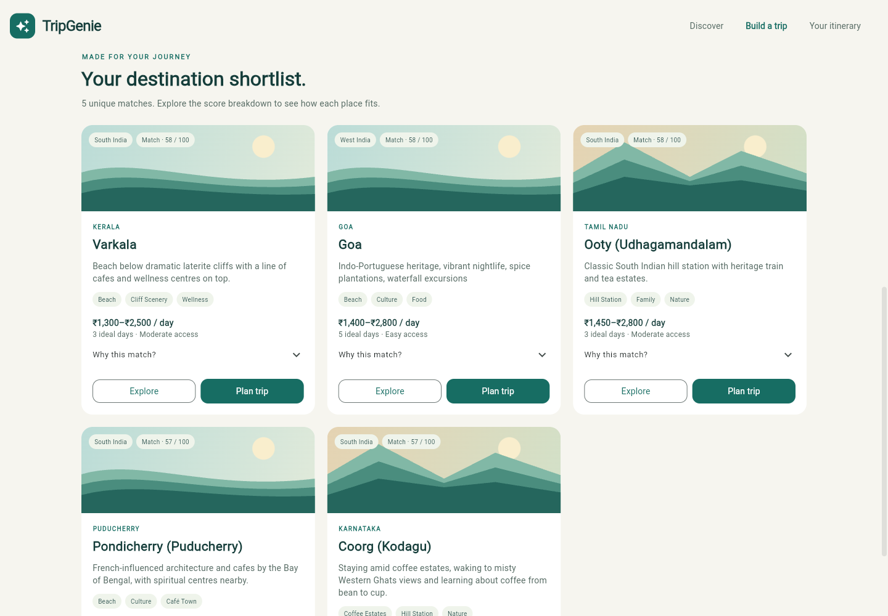

# TripGenie

Personalized India destination discovery and flexible trip planning, built with Flutter, Flask, TF-IDF, and an explainable metadata/content hybrid. Inspired by the Safarnaama research project; this repository does not reproduce its experiments.

[](https://github.com/NehaMasurkarr/tripgenie/actions/workflows/ci.yml)

## What it does

- Discover destinations by search, state/location, interests, and optional season, budget, and duration filters.
- Personalize a top-five shortlist using content, popularity, interests, budget, season, and trip length, with configurable weights and transparent score breakdowns.
- Explore catalogue facts and generate deterministic day-by-day drafts using source attractions and activities.
- Use a responsive Flutter interface with loading, retry, form validation, error, and empty states.
- Preserve original records and source variants; suppress repeated normalized names in recommendation results.

There are no invented user ratings or collaborative filtering. Recommendations are catalogue matches; confirm current travel conditions, permits, prices, and opening hours before booking.

## Interface



[Discovery](docs/screenshots/desktop-discovery.png) · [Mobile discovery](docs/screenshots/mobile-discovery.png) · [Itinerary](docs/screenshots/desktop-itinerary.png)

## Launch locally

Validated with Python 3.12 (also tested in a fresh Python 3.13 environment), Flutter 3.35.4 / Dart 3.9.2, and Chrome. Ports below avoid macOS's common port-5000 conflict.

**Terminal 1 — from the repository root:**

```sh
python3 -m venv .venv
source .venv/bin/activate
python -m pip install -r backend/requirements-dev.txt
python -m flask --app backend.app:create_app run --host 127.0.0.1 --port 5001
```

If `.venv` already exists, activate it and install dependencies; recreation is unnecessary. On Windows, activate with `.venv\Scripts\activate`; use the Flask command for local development (Gunicorn targets POSIX hosts).

**Terminal 2 — from the repository root:**

```sh
cd frontend
flutter pub get --enforce-lockfile
flutter run -d chrome --web-port 5173 --dart-define=API_BASE_URL=http://127.0.0.1:5001
```

The browser opens the app. API readiness: [http://127.0.0.1:5001/health](http://127.0.0.1:5001/health). The API must stay running while using the frontend.

For the release web build used in browser validation:

```sh
cd frontend
flutter build web --release --no-web-resources-cdn --dart-define=API_BASE_URL=http://127.0.0.1:5001
python3 -m http.server 5173 --bind 127.0.0.1 --directory build/web
```

Open [http://127.0.0.1:5173](http://127.0.0.1:5173). For a WSGI API launch from the root, use `gunicorn -c backend/gunicorn.conf.py 'backend.app:create_app()'`. Public deployment additionally needs HTTPS, a reachable API URL, exact CORS configuration, and reverse-proxy request/rate limits.

## Configuration

[.env.example](.env.example) documents `TRIPGENIE_DATA_PATH`, `TRIPGENIE_LOG_LEVEL`, and `TRIPGENIE_ALLOWED_ORIGINS`. Export them in the shell (a `.env` file alone is not a guaranteed loader); defaults work locally. `TRIPGENIE_BIND` controls the Gunicorn address. `API_BASE_URL` is a public Flutter build-time value: changing it requires restarting/rebuilding Flutter. No secrets are required for catalogue use; never put credentials in Flutter build defines or commit `.env` files.

CORS defaults allow exactly `http://localhost:5173` and `http://127.0.0.1:5173`. Different ports/hosts require a matching allowlist. An HTTPS frontend needs an HTTPS API to avoid browser mixed-content blocking. Android emulators typically reach a host API through `10.0.2.2`; see [frontend setup](frontend/README.md).

## Tests and evaluation

From the root, with the Python environment activated:

```sh
python -m pytest -q
python scripts/validate_notebooks.py
MPLCONFIGDIR=/tmp/tripgenie-matplotlib python -m backend.evaluation --output artifacts/evaluation
```

The notebook validator executes temporary copies and checks original file hashes. It leaves existing notebook edits and datasets untouched.

```sh
cd frontend
dart format --output=none --set-exit-if-changed lib test
flutter analyze
flutter test --reporter expanded
```

With the real API and release static frontend running, from the root:

```sh
python -m pip install playwright==1.63.0
python -m playwright install chromium
python scripts/browser_smoke.py --output artifacts/browser
```

Alternatively, set `PLAYWRIGHT_BROWSER_EXECUTABLE` to an installed Chrome binary. See [validation notes](docs/validation.md) for the exact tested scope. GitHub Actions runs Python, notebook, Flutter, and real-browser checks automatically.

[Evaluation report](docs/evaluation/README.md): 20 metadata-derived interest queries and 93 distinct-name synthetic profiles. Masked-content precision@5 is 0.540 versus 0.110 for seeded random retrieval; preference nDCG@5 is 0.866 for hybrid and 0.668 for content-only. These are **weak-label/proxy metrics**, not real user accuracy or satisfaction. [Notebook 05](notebooks/05_model_evaluation.ipynb) explains the methodology, direct-label leakage, baselines, and limitations.

## Repository guide

| Location | Purpose |
|---|---|
| `backend/api/` | Versioned REST schemas and routes. |
| `backend/services/` | Catalogue/filter response shaping and grounded itinerary drafts. |
| `backend/recommender/` | Reusable fitted content and configurable hybrid ranking. |
| `backend/evaluation.py` | Reproducible weak-label and preference-agreement evaluation. |
| `frontend/` | Flutter web app and Android/iOS scaffolds. |
| `notebooks/01…05` | EDA, preprocessing, content, hybrid, and evaluation. |
| `data/` | Preserved source catalogue, derived features, audits, license, and attribution. |
| `tests/` | Model, evaluation, and API behavioral tests. |
| `scripts/` | Isolated notebook validation and real-browser integration smoke test. |
| `.github/workflows/ci.yml` | Read-only automated validation and artifacts. |

[API reference](docs/api.md) · [Architecture](docs/architecture.md) · [Dataset source/license](data/README.md) · [Flutter setup](frontend/README.md)

## Limits

The small catalogue has uneven coverage, conditional seasonal text, undocumented popularity methodology, inconsistent source variants, and overlapping place/circuit names. Matching weights are heuristics. Itineraries are not route-optimized and costs have unverified per-person/transport assumptions. There is no live inventory, booking, authentication, persistent saved trips, or offline API. Native Android/iOS builds/signing and production-scale load/security testing have not been verified; mobile web responsiveness is tested. Independent relevance judgments or consented interaction data are required before tuning for real user outcomes.

The dataset is attributed to Venkata Sai Sushanth Bongarala on Kaggle and published under Apache 2.0; see [data/README.md](data/README.md), [LICENSE-2.0.txt](data/LICENSE-2.0.txt), and [NOTICE](data/NOTICE). Dataset licensing does not assign a license to application code.
