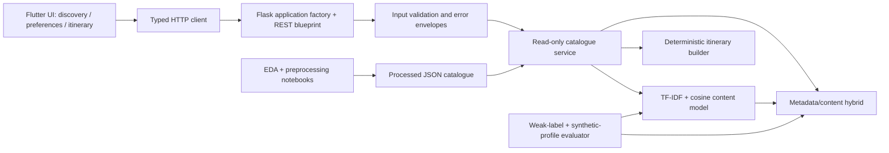

# Architecture

## Runtime boundaries

- `backend/app.py` creates configured Flask applications and fits one catalogue/model instance per worker. Readiness checks succeed only after data/model initialization. Request IDs, safe logging, body limits, restricted CORS, and JSON errors live at the HTTP boundary.
- `backend/api/` validates public schemas and routes requests. Unknown fields and malformed types fail before scoring. No request data is persisted.
- `backend/services/catalogue.py` exposes presentation-safe summaries, exact source-variant details, discovery filters, and recommendation response shaping. Eligible variants are selected before ranking/deduplication. Original records remain unchanged.
- `backend/recommender/` contains reusable content and hybrid classes. TF-IDF is fitted once; requests transform queries and score the sparse corpus. Configurable hybrid weights combine content, popularity, interests, cost, season, and duration. They are heuristics, not learned user behavior.
- `backend/services/itinerary.py` allocates actual source attractions and activities across requested days. It adds no invented places, opening hours, distances, transport reservations, or optimized routes.
- `frontend/lib/services/` handles HTTP configuration, timeouts, errors, and JSON decoding; `models/` defines typed view data; `screens/` handles preferences, detail, and itinerary UI; `widgets/` provides responsive cards and code-drawn decorative landscapes. State remains in the current app session.

## Data and identity

The Apache-2.0 Kaggle catalogue has 100 source entries and 93 exact destination-name labels. Original and processed JSONs are read only during application use. Nested fields, missing indicators, cleaned tags, budgets, and provenance come from preprocessing. Costs are described as INR daily estimates by the publisher; per-person assumptions are unverified.

The display policy keeps one eligible variant per Unicode/case/whitespace-normalized destination name. It excludes all variants of a selected name. Different names/circuits may still describe overlapping physical places; this is not completed geographic entity resolution. Conflicting facts are not merged. The duplicate report remains available for review.

## Evaluation and operations

The evaluator compares weak-label interest retrieval with masked-text, popularity, and seeded-random baselines. It also measures preference agreement, nDCG, coverage/diversity, exclusion invariants, and local warm-model latency across catalogue-derived profiles. These are proxies, not held-out user outcomes; [the report](evaluation/README.md) states leakage and sampling limits.

GitHub Actions runs Python tests, isolated notebook execution, Flutter formatting/analysis/tests/build, and a Chromium end-to-end flow against actual Gunicorn/static services. Generated artifacts contain reports and screenshots, not credentials. Push workflows target `develop`; CI has read-only repository permissions.

For public deployment, serve the API behind HTTPS with reverse-proxy rate limits and timeouts. Use the provided Gunicorn configuration on POSIX hosts; no Flask debug server in production. A separately hosted web build needs its public API URL at build time and an exact CORS allowlist entry. API workers duplicate the small fitted corpus in memory; there is no external database/cache, authentication, booking service, or collaborative model. Native platform builds and production load testing remain separate validation tasks.
