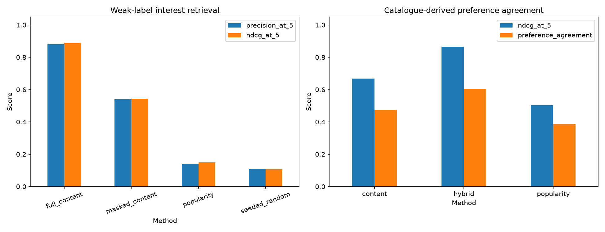
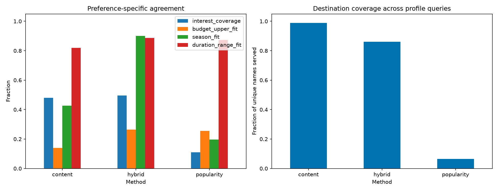

# Evaluation report

Reproduce from the repository root:

```sh
MPLCONFIGDIR=/tmp/tripgenie-matplotlib python -m backend.evaluation --output docs/evaluation
```

Use [notebook 05](../../notebooks/05_model_evaluation.ipynb) for explanations and inline figures. The report covers 20 interest-tag queries and 93 distinct-name destination profiles with seed 42. `summary.json` records the processed-file checksum and aggregate results; CSVs retain query-level measurements. Timing changes between machines/runs.

## Measured snapshot

| Interest retrieval | Precision@5 | MAP@5 | nDCG@5 |
|---|---:|---:|---:|
| Masked content | 0.540 | 0.440 | 0.545 |
| Full content | 0.880 | 0.846 | 0.891 |
| Popularity | 0.140 | 0.100 | 0.149 |
| Seeded random | 0.110 | 0.058 | 0.108 |

Masked content removes direct trip tags, name, and geography fields from TF-IDF input. Source trip tags supply weak labels grouped by destination name. Full content includes the labels, so its values are not an independent accuracy estimate.

| Synthetic-profile ranking | Preference nDCG@5 | Mean preference agreement | Catalogue coverage |
|---|---:|---:|---:|
| Content | 0.668 | 0.474 | 0.989 |
| Hybrid | 0.866 | 0.603 | 0.860 |
| Popularity | 0.504 | 0.387 | 0.065 |

Grades average interest coverage, upper-end budget fit, duration-range fit, and season match when present. Hybrid optimizes related metadata, so these are consistency/preference-agreement metrics, not real user outcomes. Ideal nDCG uses the best eligible source variant per destination name. All three ranking methods returned five results per profile with zero duplicate-name or selected-name violations.





There are no invented user ratings, interaction logs, held-out user labels, or collaborative models. The masked corpus can still contain semantically revealing descriptive wording. Synthetic profiles derive from catalogue entries and are not a representative traveler sample. Latency is warm-model sequential local timing, not an API load or deployment benchmark. Obtain independent relevance judgments before tuning weights or claiming user satisfaction improvements.
